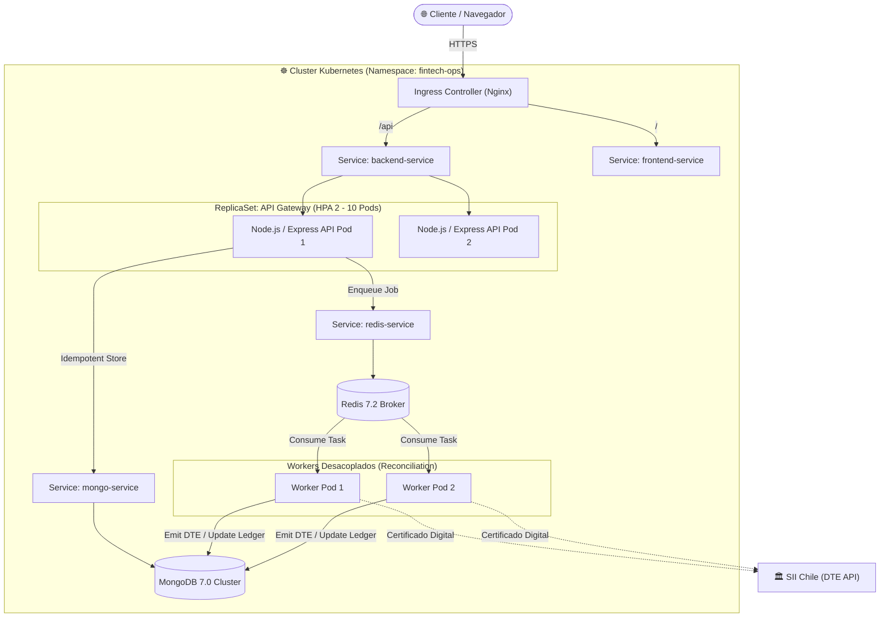
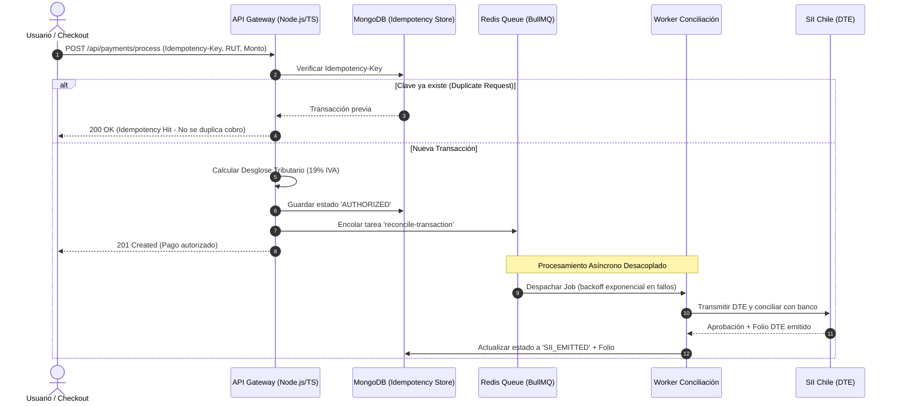

# ⚡ Financial Operating System (OS) — Microservicios & Conciliación SII

[](https://github.com/juanCovili/fintech-ops-engine/actions)
[](https://juanCovili.github.io/fintech-ops-engine/)
[](https://nodejs.org/)
[](https://www.typescriptlang.org/)
[](https://vuejs.org/)
[](https://kubernetes.io/)
[](backend/tests/)

> **Showcase de Arquitectura Financiera & DevOps:** Plataforma desacoplada de orquestación de pagos de alto tráfico, colas asíncronas con **Redis / BullMQ**, cálculo tributario chileno (19% IVA) y conciliación con el **SII (Documentos Tributarios Electrónicos - DTE)**, empaquetado en contenedores **Docker** y desplegado en **Kubernetes (HPA + Probes)** con integración continua en **GitHub Actions**.

👉 **[PROBAR DEMO INTERACTIVA EN VIVO (GitHub Pages)](https://juanCovili.github.io/fintech-ops-engine/)**

---

## 🏗️ Diagrama de Arquitectura en Kubernetes



---

## 🔄 Flujo Transaccional & Conciliación Tributaria



---

## 🛠️ Stack Tecnológico Implementado

| Capa | Tecnologías | Propósito |
| :--- | :--- | :--- |
| **Backend** | `Node.js 20`, `TypeScript 5.4`, `Express` | Microservicio de pagos, control de idempotencia y API REST. |
| **Frontend** | `Vue 3`, `Vite`, `Tailwind CSS`, `TypeScript` | Panel de control en tiempo real con monitoreo de métricas y feed transaccional. |
| **Colas & Caché** | `Redis 7`, `BullMQ` | Procesamiento asíncrono desacoplado, reintentos con backoff exponencial. |
| **Base de Datos** | `MongoDB 7.0`, `Mongoose` | Almacenamiento no relacional indexado con claves de idempotencia únicas. |
| **DevOps / Infra** | `Docker`, `Docker Compose`, `Kubernetes (K8s)` | Despliegue contenerizado, Horizontal Pod Autoscaling (HPA) y Probes de salud. |
| **Calidad & CI/CD** | `Jest`, `ts-jest`, `GitHub Actions` | Pruebas unitarias de desglose tributario, validación de RUT y pipeline automatizado. |

---

## 🔒 Patrones Financieros & Resiliencia

1. **Idempotencia Garantizada:** Cada transacción requiere un `idempotencyKey` único en base de datos. Si la red se corta y el cliente reintenta, el sistema devuelve la transacción original sin duplicar el cobro.
2. **Desglose Tributario Automático (SII Chile):** Cálculo exacto de monto neto y 19% de IVA para facturación electrónica DTE.
3. **Workers Desacoplados con BullMQ:** Si el servidor del SII o el banco experimenta latencia o caída temporal, los pagos no se bloquean: quedan seguros en la cola de Redis y se reintentan automáticamente con backoff exponencial.
4. **Zero-Downtime en Kubernetes:** Manifiestos con `readinessProbe` y `livenessProbe` para que el tráfico solo llegue a pods 100% listos. `HorizontalPodAutoscaler` (HPA) escala de 2 a 10 réplicas al superar 70% de CPU.

---

## 🚀 Despliegue Rápido Local (1 Comando)

### Prerrequisitos
- Docker & Docker Compose instalados.

### Ejecución:
```bash
# 1. Clonar el repositorio
git clone https://github.com/juanCovili/fintech-ops-engine.git
cd fintech-ops-engine

# 2. Levantar todo el stack contenerizado (Mongo + Redis + API + Worker + Vue UI)
docker compose up --build
```
- **Panel Web (Vue 3):** `http://localhost:3000`
- **API Healthz:** `http://localhost:4000/healthz`
- **Simulación:** Abre el panel web y presiona `+ Disparar Pago Idempotente`. Verás el pago pasar de `AUTHORIZED` a `SII_EMITTED` en menos de 2 segundos.

---

## ☸️ Despliegue en Kubernetes (Producción)

```bash
# Aplicar todos los manifiestos ordenados en el namespace 'fintech-ops'
kubectl apply -f k8s/00-namespace.yaml
kubectl apply -f k8s/
```

Para verificar pods y autoscaling:
```bash
kubectl get pods -n fintech-ops
kubectl get hpa -n fintech-ops
```

---

## 🧪 Pruebas Unitarias & Cobertura (Jest)

Documentación completa en [`backend/tests/README.md`](backend/tests/README.md).

```bash
cd backend
npm test
```
* Pruebas de cálculo de IVA chileno (19%) sin desfase de decimales.
* Validación de formato de RUT chileno.
* Pruebas de concurrencia y claves de idempotencia.
* Validación de generación de Folios DTE y Track IDs.

---

## 👤 Autor
**Juan Covili** — Ingeniero en Informática (INACAP)  
[LinkedIn](https://www.linkedin.com/in/juanCovili/) • [GitHub](https://github.com/juanCovili)
